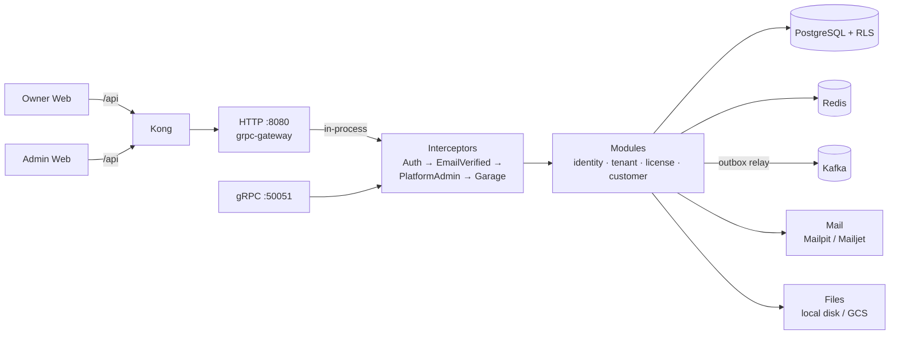

# VietGara Backend

> **Purpose:** This repo is the **VietGara backend**: a Go modular monolith that serves the gRPC and REST/JSON API used by every VietGara web and mobile app.

| | |
| --- | --- |
| **Type** | Backend service (Go), deployed as a container image |
| **Used by** | `vietgara-owner-web`, `vietgara-admin-web`, and the four Flutter apps (through Kong) |
| **Does** | Identity and access, tenants and licensing, customers, the parts catalogue and units of measure, quotes, repair orders, inventory, billing and settlement, documents, reporting, notifications |
| **Built with** | Go, gRPC + grpc-gateway, PostgreSQL (row-level security), Redis, Kafka, Mailjet |
| **Depends on** | `vietgara-proto` (API contracts), Postgres, Redis, Kafka |
| **Related** | `vietgara-infra` (how it is run), `vietgara-gitops-config` (target deployment), `vietgara-docs` (architecture) |

The Go modular monolith behind the VietGara front ends: the owner web
(`vietgara-owner-web`), the platform admin (`vietgara-admin-web`) and the
mobile apps. One
process serves:

- **gRPC** on `GRPC_PORT`, using the contracts in `vietgara-proto`.
- The **REST/JSON API** on `HTTP_PORT` under `/api/v1`. grpc-gateway builds
  it from the same contracts and serves it in-process, so every REST call
  passes through the same interceptors as a gRPC call. With
  `API_DOCS_ENABLED`, a [Scalar](https://scalar.com) API reference to read and
  try it is served at `/api/docs` (`http://localhost:8000/api/docs` in Compose).



**Contents:** [Modules](#modules) · [Run locally](#run-locally) ·
[Configuration](#configuration) · [Platform admins](#platform-admins) ·
[E-mail](#e-mail) · [File storage](#file-storage) · [Events](#events) ·
[Development](#development) · [Container image and staging](#container-image-and-staging)

## Modules

| Module | Package | Owns |
| --- | --- | --- |
| Identity | `internal/identity` | Users, sessions, e-mail verification and password-reset OTPs, Google sign-in, platform admins |
| Tenant | `internal/tenant` | Garages, staff, invitations, roles and staff groups |
| License | `internal/license` | Plans, per-user subscriptions, entitlements, plan limits |
| Customer | `internal/customer` | Customers, vehicles |
| Supplier | `internal/supplier` | The garage's suppliers with contact and bank details (FR-SUP-01) |
| Data Import | `internal/dataimport` | Excel templates, preview and all-or-nothing confirm for parts, goods receipts and stock counts (FR-INV-14); the `import_runs` history that makes a confirmed file idempotent. Parts barcodes (FR-INV-13) belong to Catalogue |

Shared infrastructure (db, access, mail, storage, kafka, outbox, audit,
httpapi, auth) is in `internal/platform`. The gRPC interceptors are in
`internal/middleware`.

## Run locally

Start the full stack with Docker Compose:

```bash
cp .env_example .env
docker compose up --build        # Postgres, Redis, Kafka, Mailpit, backend, owner web, admin web, Kong
open http://localhost:8000       # owner web through Kong
open http://admin.localhost:8000 # platform admin through Kong (plans, subscriptions)
open http://localhost:8025       # Mailpit: every e-mail sent locally
```

Or run only the dependencies in Compose and the backend on the host:

```bash
docker compose up -d vietgara-pgsql vietgara-redis vietgara-kafka vietgara-mailpit
make run                         # loads .env when present
```

To get into the admin pages, sign up with the e-mail set in
`PLATFORM_ADMIN_EMAILS` (`admin@viettechno.com` in `.env_example`) and then
restart the backend. See [Platform admins](#platform-admins).

### Database roles

On startup the server:

1. Applies the migrations as the schema owner (`MIGRATION_DATABASE_URL`).
2. Creates the `APP_DB_USER` login in the `vietgara_app` role, if that login
   does not exist yet.
3. Connects with `DATABASE_URL` as that login.

`vietgara_app` does not have `BYPASSRLS`, so row-level security applies to
every query the application runs. [`db/README.md`](db/README.md) covers
migrations and RLS.

## Configuration

Every setting is an environment variable. `.env_example` lists them all with
local defaults.

**Database and server**

| Variable | Purpose |
| --- | --- |
| `DATABASE_URL` | Application connection, as a `vietgara_app` login |
| `MIGRATION_DATABASE_URL` | Schema-owner connection for migrations. Defaults to `DATABASE_URL` |
| `APP_DB_USER`, `APP_DB_PASSWORD` | Login created in `vietgara_app` on startup, if set |
| `RUN_MIGRATIONS`, `MIGRATIONS_PATH` | Apply `db/migrations` on startup |
| `GRPC_PORT`, `HTTP_PORT` | Listener ports |
| `API_DOCS_ENABLED` | Serve the API reference at `/api/docs` and the OpenAPI document at `/api/openapi.json`. Defaults to `false`; Compose turns it on |

**Identity and access**

| Variable | Purpose |
| --- | --- |
| `JWT_SIGNING_KEY`, `JWT_ACCESS_TTL`, `JWT_REFRESH_TTL` | Token signing and lifetimes. Generate the key with `openssl rand -hex 32` |
| `MFA_ENCRYPTION_KEY` | Key (64 hex characters, `openssl rand -hex 32`) that encrypts the TOTP secrets of two-factor authentication (FR-IAM-09) at rest. Empty turns MFA off: the sign-in never asks for a second factor and `/me/mfa` answers `MFA_NOT_CONFIGURED`. Changing the key makes the enrolled secrets unreadable, so keep it with the other secrets |
| `GOOGLE_CLIENT_ID`, `GOOGLE_CLIENT_SECRET` | Google sign-in popup. Register `APP_BASE_URL` + `/api/v1/auth/google/callback` as the redirect URI |
| `GOOGLE_MOBILE_CLIENT_IDS` | Google sign-in from the mobile apps (`POST /api/v1/auth/google/id-token`): comma-separated OAuth client IDs the apps' ID tokens are issued to (the Android "web/server" client and the iOS client). Empty disables it |
| `GOOGLE_AUTH_ENDPOINT`, `GOOGLE_TOKEN_ENDPOINT`, `GOOGLE_USERINFO_URL`, `GOOGLE_CERTS_URL` | Google's OAuth endpoints and the JWKS that mobile ID tokens are verified against. Default to Google's own; override them only to point the backend at a Google stub (the blackbox tests) |
| `PLATFORM_ADMIN_EMAILS` | Comma-separated e-mails granted platform admin. See [Platform admins](#platform-admins) |
| `APP_BASE_URL` | Public URL of the deployment, such as `https://vietgara.viettechno.com`. The owner web origin for the Google popup, the Google callback host, and the base of e-mailed links. Defaults to `http://localhost:8000` |
| `ADMIN_APP_BASE_URL` | Public URL of the platform admin web, the base of the platform staff invitation links (`<url>/invitations/<id>`). Defaults to `http://admin.localhost:8000` |

**Cache, licensing and events**

| Variable | Purpose |
| --- | --- |
| `REDIS_ADDR`, `REDIS_PASSWORD` | Sessions, OTPs, entitlement cache and transaction counters. If empty, these are kept in memory (single instance only) |
| `ENTITLEMENT_CACHE_TTL`, `LICENSE_EXPIRY_JOB_INTERVAL` | License enforcement |
| `KAFKA_BROKERS`, `KAFKA_TOPIC_PREFIX`, `KAFKA_CONSUMER_GROUP`, `OUTBOX_RELAY_INTERVAL` | Domain events. If `KAFKA_BROKERS` is empty, events are delivered in-process. See [Events](#events) |

**Observability**

| Variable | Purpose |
| --- | --- |
| `METRICS_PORT` | Port of the Prometheus endpoint `/metrics` (default `9090`). It is a separate listener that the gateway does not route and the deployment must not publish; scrape it from inside the network. See [Observability](#observability) |
| `OTEL_EXPORTER_OTLP_ENDPOINT` | OTLP endpoint for traces. If empty, spans are created (so logs carry a trace id) but not exported |

**E-mail and files**

| Variable | Purpose |
| --- | --- |
| `MAIL_PROVIDER`, `MAIL_FROM_ADDRESS`, `MAIL_FROM_NAME` | E-mail provider and sender. See [E-mail](#e-mail) |
| `SMTP_HOST`, `SMTP_PORT`, `SMTP_USERNAME`, `SMTP_PASSWORD` | SMTP provider (Mailpit) |
| `MAILJET_API_KEY`, `MAILJET_SECRET_KEY` | Mailjet provider |
| `STORAGE_BACKEND`, `STORAGE_LOCAL_DIR`, `STORAGE_PUBLIC_BASE_URL`, `STORAGE_GCS_BUCKET`, `STORAGE_GCS_PRIVATE_BUCKET`, `STORAGE_SIGNING_KEY` | Uploaded files. See [File storage](#file-storage) |

**Test users (staging only)**

| Variable | Purpose |
| --- | --- |
| `APP_ENV` | `production` on the production VM: the server then refuses to start with `TEST_USERS_EMAIL_DOMAIN` set. Other values (`staging`, empty) change nothing |
| `TEST_USERS_EMAIL_DOMAIN` | E-mail domain of the blackbox suite's users, under `.test`, `.example`, `.invalid` or `.localhost`. Unset (the default, and always in production) disables everything below. See [Test users](#test-users) |
| `TEST_USERS_SMTP_HOST`, `TEST_USERS_SMTP_PORT` | SMTP server (Mailpit) that receives the test users' e-mail. Required with the domain; port defaults to `1025` |
| `TEST_USERS_RETENTION` | How long a test user lives before it is purged with everything it owns. Defaults to `24h` |

## Platform admins

Platform admins manage plans and subscriptions (FR-IAM-08, FR-LIC-05). They
do not belong to any garage and cannot see a garage's business data. There
can be any number of them. Admin rights come only from configuration: no
screen or API grants them.

### Granting admin rights

1. The person signs up for a normal user, with e-mail/password or Google.
2. Add their e-mail to `PLATFORM_ADMIN_EMAILS` for that environment:

   ```bash
   PLATFORM_ADMIN_EMAILS=admin@viettechno.com,ops@viettechno.com
   ```

3. Restart the backend. On startup it adds every user whose e-mail is in
   the list (matched case-insensitively) to the `platform_admins` table, then
   logs `platform admins granted` with the number of new grants.

The `platform_admin` flag in the access token is read from the database each
time a session is issued or refreshed. It therefore takes effect within
`JWT_ACCESS_TTL` (20 minutes by default), or at once if the person signs out
and back in. The admin web (`vietgara-admin-web`) accepts only users that
have the flag; others see an access-denied page. The owner web has no
platform-admin pages.

Things to know:

- **The user must exist before the restart.** The server skips e-mails
  that have no user. A skipped e-mail is not granted later when that person
  signs up, so they must sign up first and the backend must restart after
  that.
- **The list only adds admins.** Removing an e-mail from
  `PLATFORM_ADMIN_EMAILS` does not revoke anyone. To revoke an admin, delete
  their row by hand:

  ```sql
  DELETE FROM platform_admins
  WHERE user_id = (SELECT id FROM users WHERE lower(email) = 'ops@viettechno.com');
  ```

  The change takes effect when that person's current access token expires.
- **Each environment has its own list.** Locally it comes from `.env`, through
  `docker-compose.yml`. In staging and production, set it in that deployment's
  configuration.

## E-mail

E-mails (verification OTP, password-reset OTP, staff invitation) are rendered
from `internal/platform/mail/templates/{vi,en}` in the recipient's language.
One of two providers sends them:

| Environment | `MAIL_PROVIDER` | Where mail goes |
| --- | --- | --- |
| Local, unit and integration tests | `smtp` | [Mailpit](https://mailpit.axllent.org/): SMTP on port `1025`, inbox UI on port `8025` |
| Staging, production | `mailjet` | [Mailjet](https://www.mailjet.com/) Send API v3.1 |

How failures are handled:

- The server refuses to start if `MAIL_PROVIDER=mailjet` and a Mailjet key is
  missing.
- If an OTP e-mail cannot be sent, the request fails and the code is
  discarded, so the user can retry right away.
- Invitation e-mails are sent after the invitation is committed. If sending
  fails, the error is logged and the invitation still appears on the
  invitee's Invitations page.

### Test users

The blackbox suite (`testing/blackbox`) signs up its own users, including
on staging, where real e-mail goes through Mailjet and the suite cannot read
it. With `TEST_USERS_EMAIL_DOMAIN` set:

- Every e-mail to an address on that domain goes to `TEST_USERS_SMTP_HOST`
  (a Mailpit the suite reads OTPs from) instead of the configured provider.
  All other e-mail is unchanged. Authentication itself is not changed:
  these users get random OTPs, with the usual expiry and attempt limits.
- The domain must be under a TLD reserved for testing, so no real person
  can own an address on it. The server refuses to start otherwise.
- Every hour, users on the domain older than `TEST_USERS_RETENTION`
  are deleted with everything they own. Uploaded files under each owned
  garage's storage prefix are removed before database deletion; garages and
  their data, staff memberships and subscriptions go by foreign-key cascade.

Never set it in production.

### Setting up Mailjet

1. Create a Mailjet user. Under **User settings → Senders & domains**,
   add the product's sending domain: `vietgara.viettechno.com` in production,
   `vietgara-staging.viettechno.com` in staging. A subdomain of its own keeps
   the product's sending reputation and bounces apart from the company's
   mailboxes on `viettechno.com`.
2. Publish the SPF and DKIM DNS records that Mailjet shows for the domain.
   Wait until both are validated: mail from an unvalidated sender is rejected
   or lands in spam.
3. Under **User settings → API key management**, create a key pair. Use a
   separate pair for each environment.
4. Configure the backend. Keep the secret in Secret Manager, never in the
   repository.

   ```bash
   MAIL_PROVIDER=mailjet
   MAIL_FROM_ADDRESS=no-reply@vietgara.viettechno.com   # a validated sender
   MAIL_FROM_NAME=VietGara
   MAILJET_API_KEY=<api key>
   MAILJET_SECRET_KEY=<secret key>
   ```

5. Trigger a verification e-mail, then check delivery under **Statistics →
   Messages** in Mailjet. Staging sends as
   `no-reply@vietgara-staging.viettechno.com`, so test mail is easy to tell
   apart.

## File storage

Every upload is registered in the `files` table (the File module,
`internal/file`) with its owner, kind and object key; business rows keep the
key, never the URL. Object keys are
`garages/{garageId}/{kind}/{entityId}/{uuid}.{ext}` and
`users/{userId}/{kind}/{uuid}.{ext}`. `internal/platform/storage` stores the
objects. A kind is **public** (the garage logo: served by URL) or **private**
(every later kind: served only through short-lived signed URLs):

| Environment | `STORAGE_BACKEND` | Notes |
| --- | --- | --- |
| Local, staging | `local` | Files are written under `STORAGE_LOCAL_DIR` (Compose mounts the `vietgara-uploads` volume there) and public ones served at `/api/v1/files/…`. Private ones live under `_private/` and are served at `/api/v1/files/private/…` only for an HMAC-signed, expiring URL; `STORAGE_SIGNING_KEY` is the secret (a random one per process when unset, so URLs stop working at a restart; set it on staging) |
| Production | `gcs` | Public files go to the `STORAGE_GCS_BUCKET` bucket and private ones to `STORAGE_GCS_PRIVATE_BUCKET`, which must not be public. Credentials come from the workload identity (Application Default Credentials); V4 URLs are signed through the IAM Credentials API, so the service account needs `roles/iam.serviceAccountTokenCreator` on itself. `STORAGE_PUBLIC_BASE_URL` is the public URL prefix, either the bucket or a CDN |

The test-user purge command uses these same `STORAGE_*` settings. It removes
all objects, public and private, under each eligible test user's garage
prefix (including old, unreferenced logo uploads), and stops before deleting database users if file
cleanup fails.

## Events

1. Modules write domain events to the transactional outbox.
2. A relay publishes them to the Kafka topics `<prefix>.<context>.events`,
   for example `vietgara.identity.events`.
3. Consumers record the ids of handled events in `processed_events`, retry
   with backoff, and move events that keep failing to `<topic>.dlq`.

Without `KAFKA_BROKERS`, events are delivered in-process after commit. The
event catalogue is in the Event Design document.

## Observability

- **Health.** `GET /healthz` is liveness (the process answers). `GET /readyz`
  is readiness: it answers `503` while the database does not, so a load
  balancer or Kubernetes stops sending traffic.
- **Metrics** (`:9090/metrics`, Prometheus format), per module (the second
  element of the proto package, for example `quote`):
  `vietgara_requests_total{module,code}`,
  `vietgara_request_errors_total{module}` (server-side faults, HTTP 5xx),
  `vietgara_request_duration_seconds{module}`, the database pool
  (`vietgara_db_pool_*`), `vietgara_outbox_pending_events`,
  `vietgara_outbox_oldest_pending_age_seconds`, `vietgara_outbox_failed_events`
  and `vietgara_kafka_consumer_lag{topic}`. The outbox and lag values are read
  at most every 5 seconds; a failed read exports no series and raises
  `vietgara_collector_errors_total`.
- **Logs** are JSON on stderr. Every request writes one line (`request`,
  `request rejected` or `request failed`) with `module`, `method`, `code`,
  `duration_ms`, `trace_id` and `garage_id`; a failed request also carries the
  `error` cause that the client never sees. Any record logged with a context
  (`slog.*Context`) gets `trace_id` and `garage_id` too.
- Alert rules, dashboards and log shipping live in `vietgara-infra`
  (`staging/observability`).

## Development

```bash
make help               # list every target
make test-unit          # unit tests with the 90% coverage gate
make test-integration   # repository and migration tests on a disposable Postgres (testcontainers)
make lint               # golangci-lint
make blackbox-stubbed   # API-level tests of the built image with stubbed third parties (testing/blackbox)
make loadtest-stubbed   # k6 load test of about 50 garages against the stubbed stack (testing/loadtest, about 14 minutes)
make generate-mocks     # mockery
make migrate-up         # apply migrations; also migrate-down N=…, migrate-force VERSION=…, migrate-version
```

Integration tests carry `//go:build integration` and live next to the code
they test. They get their database from `internal/platform/db/pgtest`, which
starts the same Postgres version as `docker-compose.yml`, applies
`db/migrations` the way the server does, and hands out a superuser
connection (for seeding past RLS) and a `vietgara_app` pool (subject to RLS).
`make lint` lints them too.

Locally, `go.work` in the parent directory builds against your
`vietgara-proto` checkout. CI (`.github/workflows/ci.yml`) builds against the
version pinned in `go.mod` instead. For every contract change, push and tag
`vietgara-proto`, then bump the version here.

### Security checks

CI blocks on `govulncheck` (the Go toolchain and the modules the code reaches; run it locally with
`go run golang.org/x/vuln/cmd/govulncheck@v1.9.0 ./...`) and on Trivy over the built image. Two tests keep
the authorization model honest: `TestEveryRPCDeclaresItsAuthorization` (`cmd/server`) fails when an RPC has no
policy or the anonymous surface changes, and `TestEveryTableIsClassifiedForRowLevelSecurity` (integration) fails
when a table has neither forced row-level security nor a reason in its exemption list. A new table or public RPC
therefore needs an edit in a place a reviewer sees. See the
[Security Review](https://github.com/viettechno/vietgara-docs/blob/master/docs/03-Architecture/12_Security_Review_Release_8_0.md).

### Gateway edge policy

`kong/kong.yml` holds the rate limits (sign-in and OTP routes 20 per minute per IP, the public quote link 30,
everything else 600 per bearer token), the security headers and the CORS list; `kong/error.json` makes Kong's own
errors (the `429`) use the API's error envelope. `vietgara-e2e/ci/kong.yml` and `vietgara-infra/staging/kong/kong.yml`
copy the routes with their own limits; change all three together. The blackbox stack's gateway trusts the
`X-Forwarded-For` the suite sends (`KONG_TRUSTED_IPS` in `testing/blackbox/compose.yml`), which no other environment
does; behind a proxy, set `KONG_TRUSTED_IPS`, `KONG_REAL_IP_HEADER` and `KONG_REAL_IP_RECURSIVE` so the limits count
the real client.

The blackbox suite in [`testing/blackbox`](testing/blackbox/README.md) is a
separate Go module that drives the built image over the public REST API,
locally against stubbed third parties or against staging.

The load test in [`testing/loadtest`](testing/loadtest/README.md) (Release 9.0) is a
k6 script that runs the quote-to-payment flow of about 50 garages, seeded by
`testing/blackbox/cmd/loadseed` from the shared dataset, and checks NFR-PF-01,
02 and 05.

## Container image and staging

CI (`.github/workflows/ci.yml`, job **Docker image**) builds the image on
every run and, after all checks pass, pushes it to the GitHub Container
Registry on merges to `master` and `v*` tags, as
`ghcr.io/viettechno/vietgara-backend:<git describe>` (public).

To push by hand instead, `make image-push` builds the same image for
`linux/amd64` (cross-compiled, so it also works on Apple Silicon):

```bash
echo "$GHCR_TOKEN" | docker login ghcr.io -u <github user> --password-stdin   # classic token, write:packages
make image-check        # builds without go.work, as Docker does
make image-push
```

Inside Docker there is no `go.work`, so the image uses the `vietgara-proto`
version pinned in `go.mod`. `image-check`, which `image-build` and
`image-push` run first, fails early when the backend depends on unpublished
contract changes. Pushing uncommitted work is refused unless `ALLOW_DIRTY=1`.
`make help` lists the variables (`IMAGE_NAMESPACE`, `IMAGE_TAG`,
`IMAGE_PLATFORM`).

Staging runs the published images on a VM. The Compose file, settings template
and step-by-step guide are in the `vietgara-infra` repository
(`staging/README.md`).
