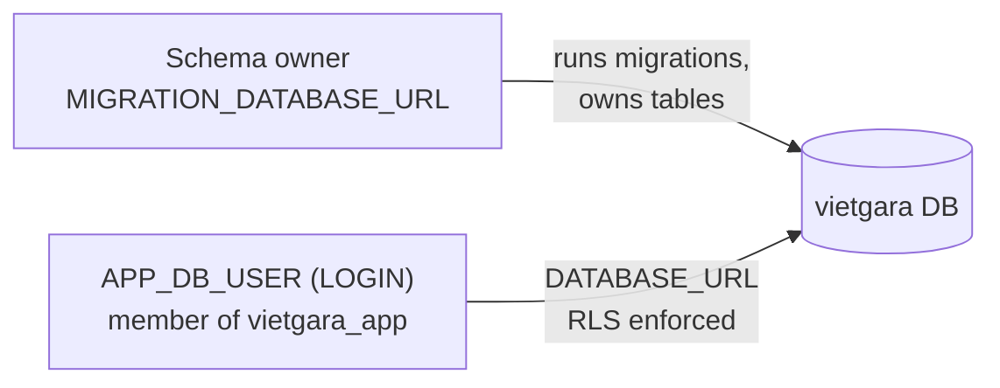
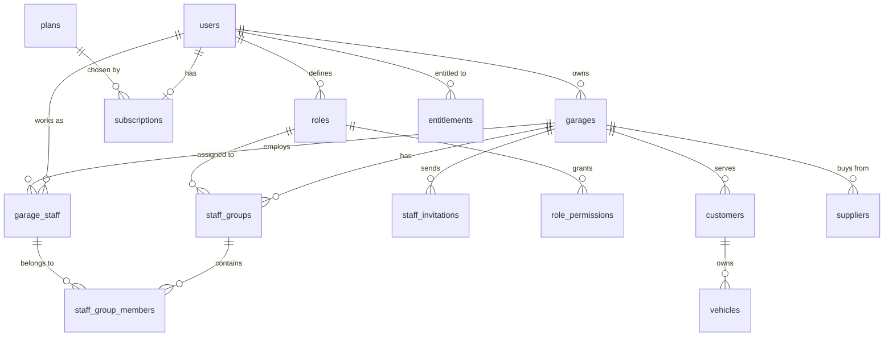

# Database Migrations & Row-Level Security (RLS)

golang-migrate migrations (`db/migrations`) for the single VietGara
PostgreSQL database. Every module keeps its tables in the `public` schema of
this one database (a modular monolith); module boundaries are kept in code,
and tenant isolation is enforced by Row-Level Security.

## Migrations

Each migration creates one object, or two that belong together: a table with
its enum types, constraints, indexes, triggers, row-level security policies
and seed rows; a shared enum; or a function. They are numbered in dependency
order, so a table comes after the tables it references. Where a policy of an
earlier table reads a later table (for example the policies of `garages`
read `garage_staff`), it is created with the later table.

Until the first real tenant exists, the migrations are edited in place and
the database is rebuilt: locally with `make docker-clean` and `make docker-up`,
on staging by wiping its database (staging holds test data only). From the
first real tenant on, every change is a new forward-only migration.

| Migrations | Creates |
| --- | --- |
| `enable_pg_trgm_extension`, `create_app_role` | Trigram search; the `vietgara_app` role (not a superuser, no `BYPASSRLS`) and the default privileges that grant it every later table and sequence. Append-only tables (`audit_log`, `notification_log`, `support_access_events`) revoke `UPDATE` and `DELETE` |
| `create_rls_context_functions`, `create_row_audit_functions` | `app_current_garage_id()` and `app_current_user_id()`, read by every policy; the row-audit trigger functions that fill `created_by` and `updated_by` (NFR-MT-07) |
| `create_<table>_table` | One file per table, in module order: identity, tenant, license, platform, customer, supplier, quote, repair order, catalogue, inventory, billing, notification, file, MFA, platform staff, support access. `db/audit_columns_test.go` fails when a table has neither the audit columns nor an allowlist entry |
| `create_<type>_enum` | An enum used by more than one table |
| `create_<name>_function` | `SECURITY DEFINER` lookups and helpers that need their tables first: `owner_usage()`, `find_customers_by_email()`, `find_quote_by_public_token()`, `file_object_key()`, `purge_idempotency_keys()` |

Tenant tables enable and `FORCE` row-level security in their own file, so
the `vietgara_app` role is always subject to the policies.

`owner_usage(owner)` returns the owner's active garages and staff (members
plus live invitations) across all their garages. It is `SECURITY DEFINER`
because RLS hides the owner's other garages from a single-garage
transaction, and it returns counts only.

## Roles and connections



- Migrations run as the schema owner. `FORCE ROW LEVEL SECURITY` also binds
  the owner, so any future data migration on a tenant table needs a role that
  bypasses RLS (the PostgreSQL superuser does, locally and in the database container
  of the staging and production VMs).
- The backend connects as `APP_DB_USER`. When the variable is set, the server
  creates that login `IN ROLE vietgara_app` on startup if it is missing
  (`db.EnsureAppLogin`). Staging and production set it this way too; the password is
  in the VM's `.env` (`vietgara-infra`), readable by its owner only.

## Row-Level Security

Every tenant table has `ENABLE` and `FORCE ROW LEVEL SECURITY`. The
application sets the scope per transaction (`db.TxManager.WithTransaction`,
`db.SetScopeSQL`):

```sql
SELECT set_config('app.current_garage_id', $1, true),
       set_config('app.current_user_id', $2, true);
```

`true` makes both settings transaction-local, so a pooled connection never
leaks a tenant to the next request. The `Garage` interceptor opens the
transaction for garage-scoped RPCs; user-scoped work (listing one's
garages, invitations, roles) runs with only the user set.

| Table | Read | Write |
| --- | --- | --- |
| `garages` | Current garage, or garages the caller owns, works in or is invited to | Current garage (insert also requires the caller as owner) |
| `garage_staff` | Current garage, or the caller's own memberships | Current garage |
| `staff_groups`, `staff_group_members` | Current garage, the owner's garages, or the caller's own groups | Current garage |
| `roles`, `role_permissions` | The caller's roles, the current garage owner's roles, roles used by visible groups | The caller's own roles |
| `staff_invitations` | Current garage, or invitations to the caller | Insert/delete: current garage; update: garage side (revoke) or invitee (accept/decline) |
| `customers`, `vehicles`, `suppliers` | Current garage | Current garage |
| `document_sequences`, `quotes`, `quote_lines`, `repair_orders`, `repair_order_lines` | Current garage | Current garage |

Platform tables (`users`, `plans`, `subscriptions`, `entitlements`,
`outbox_events`, `processed_events`, `audit_log`, `platform_admins`) have no
RLS; access to them is enforced by the owning module's service layer.

`internal/tenant/repository` integration tests (`TestRLS_TenantModel`) run as
a login in `vietgara_app` and check these rules.

## Running migrations

The server applies pending migrations on startup when `RUN_MIGRATIONS=true`.
To run them by hand, use the make targets. They run the golang-migrate CLI
pinned in `make/install.mk` through `go run`, so nothing needs installing.
They connect with `MIGRATION_DATABASE_URL`, taken from the environment or
`.env`; pass `DATABASE=<url>` to target another database:

```bash
make migrate-up                 # apply all pending migrations
make migrate-up N=1             # apply the next migration only
make migrate-down               # roll back the last migration
make migrate-down N=3           # roll back three migrations
make migrate-down N=all         # roll back everything
make migrate-version            # current version, and whether it is dirty
make migrate-force VERSION=12   # after a failed migration: mark version 12 clean (runs no SQL)
```

A failed migration leaves the database **dirty** at that version. Fix the
cause, undo whatever the failed migration partly applied, then run
`make migrate-force VERSION=<last good version>` and `make migrate-up` again.

Every migration has a tested `down`; `db/migrate_test.go` applies all of them
up, down and up again against a Postgres container.

## Schema (Release 1.1)



## Troubleshooting

- **Every query returns no rows**: the scope is not set; run the query inside
  `WithTransaction` with a garage and/or user scope.
- **`permission denied for table schema_migrations`**: the application user
  is running migrations; set `MIGRATION_DATABASE_URL` to the schema owner.
- **A data migration updates 0 rows**: the migration role is subject to
  `FORCE ROW LEVEL SECURITY`; run it with a role that bypasses RLS.
