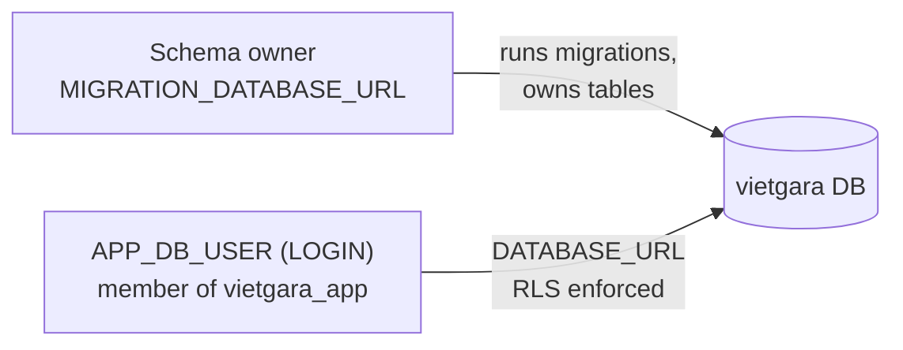
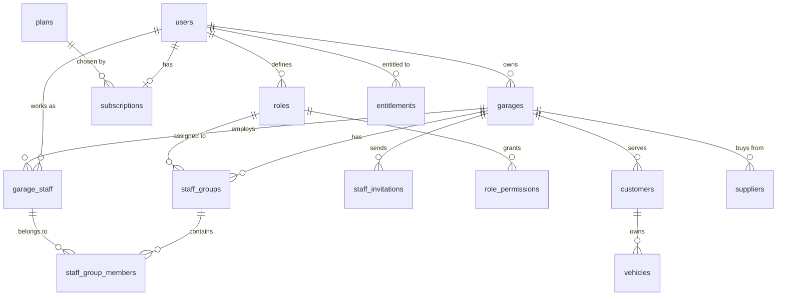

# Database Migrations & Row-Level Security (RLS)

golang-migrate migrations (`db/migrations`) for the single VietGara
PostgreSQL database. Every module keeps its tables in the `public` schema of
this one database (a modular monolith); module boundaries are kept in code,
and tenant isolation is enforced by Row-Level Security.

## Migrations

The application has not been deployed yet, so each migration creates its
objects in their final shape: a change to an existing table is made in the
migration that created it, not in a new `ALTER` migration. New migrations
are only added for new tables or objects. (Once staging or production
exists, schema changes must become new, forward-only migrations.)

**Migration freeze.** The rule is to edit in place only while no non-test tenant exists. Staging counts as test data: after an in-place change, rebuild the local database (`make docker-clean`, then `make docker-up`) and wipe the staging database before deploying. From the first real tenant, every change is a new forward-only migration.

Planned in-place changes (Release Plan, Phases 3-8; the audit columns and `full_name_source` of Release 5.0 are done): `users` and `user_id` everywhere (Phase 3, backend done in #20); `partners` becomes `suppliers` without the `partner_type` enum (done), the insurer columns, the allocation split and `payer_type` go from `settlements` and `settlement_payments` (done), voucher columns on `settlement_payments`, quantities become `NUMERIC(14,3)` and `stock_transactions.unit_cost` `NUMERIC(18,4)` (done, Release 5.0); units, categories, jobs, goods receipts and the other tables listed in the Database Design, Section 11, arrive with their releases.

| Version | Module | Creates |
| --- | --- | --- |
| 000001 | Identity | `users` with enums `user_status` (`active`, `suspended`), `user_auth_provider` (`email`, `google`), `user_locale` (`vi` default, `en`); required e-mail unique case-insensitively; `email_verified_at` |
| 000002 | Tenant | RLS helpers `app_current_garage_id()` / `app_current_user_id()`; `garages` with `garage_status` (`active`, `inactive`), `Asia/Ho_Chi_Minh` time zone, contact details, operating hours, numbering templates |
| 000003 | Tenant | `garage_staff` with `staff_status` (`active`, `inactive`); permissions come from staff groups |
| 000004 | Platform | `outbox_events` (`outbox_status`, garage or user, relay bookkeeping) |
| 000005–000007 | Customer | `customers` (consent log, trigram search), `vehicles` (normalized plate key), `suppliers` (000007, Supplier module, bank details), each with its tenant RLS policy and an `is_active` flag for the delete-or-deactivate rule (FR-CAT-07) |
| 000008 | License | `plans` (limits on garages, staff and transactions per day; `plan_feature[]`; seeded catalogue), `subscriptions` (one per owner user), `entitlements` (per user and feature) |
| 000009 | Identity | `platform_admins` |
| 000010 | Tenant | `permission` and `default_role` enums, `roles`, `role_permissions`, `staff_groups`, `staff_group_members`, the shared `set_updated_at()` trigger |
| 000011 | Tenant | `staff_invitations` (`invitation_status`, one pending invitation per garage and user) |
| 000012 | Platform | `processed_events` (idempotent consumers), `audit_log` (append-only) |
| 000013 | Platform | RLS policies of the tenant/access tables, `owner_usage()`, the `vietgara_app` role and its grants |
| 000014 | Platform | `document_sequences`: the per-garage, per-document-type, per-period counter behind numbering templates (FR-TEN-05) |
| 000015 | Quote & Pricing | `quotes` (`quote_status`, `quote_approval_mode` from 000002, the public approval token hash), `quote_lines` (`quote_item_type`, `quote_line_decision`), `find_quote_by_public_token()` |
| 000016 | Repair Order | `repair_orders` (`repair_order_status`, incl. `waiting_on_parts`), `repair_order_lines` (`repair_order_line_status`, `assigned_technicians`) -- FR-REP-01..03/06 |
| 000017 | Inventory | `items` (trigram search), `stock_balance` (per-item running total), `stock_transactions` (append-only, `stock_transaction_type`, `stock_transaction_ref_type`) -- FR-INV-01..03/05 |
| 000018 | Billing & Settlement | `settlements` (`settlement_status`, paid total), `settlement_payments` (append-only, `payment_method`) -- FR-BIL-01..03, FR-REC-01 |
| 000019 | Notification | `notification_log` (append-only, `notification_channel`, `notification_status`): what was sent, for visibility -- not a dedup mechanism, the Outbox Pattern's `processed_events` already gives exactly-once delivery -- FR-NOT-04 |
| 000020 | Customer | `find_customers_by_email()`: the Customer BFF's `SECURITY DEFINER` lookup of a person's customer records across garages (ids only) |
| 000021 | Platform | `idempotency_keys`: the stored answer of a financial request, kept 24 hours (API Specification 1.3) |
| 000022 | Platform | Row audit (NFR-MT-07): `set_row_audit()` and `set_created_audit()` and their triggers fill `created_by` / `updated_by` from `app.current_user_id` (NULL for a system job) on every business table; `created_at` / `created_by` never change; `db/audit_columns_test.go` fails when a table has neither the columns nor an allowlist entry |

Tables from 000002, 000003, 000010 and 000011 enable `FORCE ROW LEVEL
SECURITY` when created; their policies are created together in 000013,
because they reference tables created later (a garage is visible to its
staff and invitees, a role to the members of the owner's garages, and so on).

`owner_usage(owner)` returns the owner's active garages and staff (members
plus live invitations) across all their garages. It is `SECURITY DEFINER`
because RLS hides the owner's other garages from a single-garage
transaction, and it returns counts only.

## Roles and connections



- Migrations run as the schema owner. `FORCE ROW LEVEL SECURITY` also binds
  the owner, so any future data migration on a tenant table needs a role that
  bypasses RLS (the local superuser does; in Cloud SQL use a migration user
  with `BYPASSRLS`).
- The backend connects as `APP_DB_USER`. When the variable is set, the server
  creates that login `IN ROLE vietgara_app` on startup if it is missing
  (`db.EnsureAppLogin`). In staging and production, create it once instead and
  keep its password in Secret Manager.

## Row-Level Security

Every tenant table has `ENABLE` and `FORCE ROW LEVEL SECURITY`. The
application sets the scope per transaction (`db.TxManager.WithTransaction`,
`db.SetScopeSQL`):

```sql
SELECT set_config('app.current_garage_id', $1, true),
       set_config('app.current_user_id', $2, true);
```

`true` makes both settings transaction-local, so a pooled connection never
leaks a tenant to the next request. The `Garage` interceptor opens the
transaction for garage-scoped RPCs; user-scoped work (listing one's
garages, invitations, roles) runs with only the user set.

| Table | Read | Write |
| --- | --- | --- |
| `garages` | Current garage, or garages the caller owns, works in or is invited to | Current garage (insert also requires the caller as owner) |
| `garage_staff` | Current garage, or the caller's own memberships | Current garage |
| `staff_groups`, `staff_group_members` | Current garage, the owner's garages, or the caller's own groups | Current garage |
| `roles`, `role_permissions` | The caller's roles, the current garage owner's roles, roles used by visible groups | The caller's own roles |
| `staff_invitations` | Current garage, or invitations to the caller | Insert/delete: current garage; update: garage side (revoke) or invitee (accept/decline) |
| `customers`, `vehicles`, `suppliers` | Current garage | Current garage |
| `document_sequences`, `quotes`, `quote_lines`, `repair_orders`, `repair_order_lines` | Current garage | Current garage |

Platform tables (`users`, `plans`, `subscriptions`, `entitlements`,
`outbox_events`, `processed_events`, `audit_log`, `platform_admins`) have no
RLS; access to them is enforced by the owning module's service layer.

`internal/tenant/repository` integration tests (`TestRLS_TenantModel`) run as
a login in `vietgara_app` and check these rules.

## Running migrations

The server applies pending migrations on startup when `RUN_MIGRATIONS=true`.
To run them by hand, use the make targets. They run the golang-migrate CLI
pinned in `make/install.mk` through `go run`, so nothing needs installing.
They connect with `MIGRATION_DATABASE_URL`, taken from the environment or
`.env`; pass `DATABASE=<url>` to target another database:

```bash
make migrate-up                 # apply all pending migrations
make migrate-up N=1             # apply the next migration only
make migrate-down               # roll back the last migration
make migrate-down N=3           # roll back three migrations
make migrate-down N=all         # roll back everything
make migrate-version            # current version, and whether it is dirty
make migrate-force VERSION=12   # after a failed migration: mark version 12 clean (runs no SQL)
```

A failed migration leaves the database **dirty** at that version. Fix the
cause, undo whatever the failed migration partly applied, then run
`make migrate-force VERSION=<last good version>` and `make migrate-up` again.

Every migration has a tested `down`; `db/migrate_test.go` applies all of them
up, down and up again against a Postgres container.

## Schema (Release 1.1)



## Troubleshooting

- **Every query returns no rows**: the scope is not set; run the query inside
  `WithTransaction` with a garage and/or user scope.
- **`permission denied for table schema_migrations`**: the application user
  is running migrations; set `MIGRATION_DATABASE_URL` to the schema owner.
- **A data migration updates 0 rows**: the migration role is subject to
  `FORCE ROW LEVEL SECURITY`; run it with a role that bypasses RLS.
